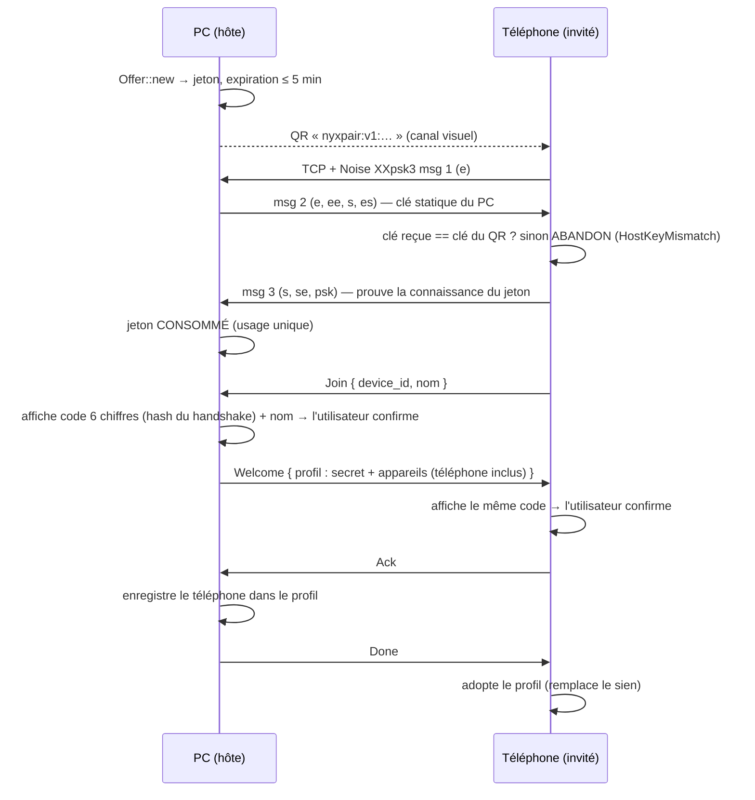

# Synchronisation entre appareils — conception et modèle de menace

> Crate : `crates/nyx-sync` · schéma du coffre : v3 (`crates/vault/src/sync.rs`)
> Phase A (ce document) : réseau local uniquement. Phase B (prévue, non
> implémentée) : relais non fiable stockant des blobs opaques.

## Comment associer ses appareils

Il faut Nyx sur l'ordinateur (Windows) et sur le téléphone (Android),
**connectés au même réseau Wi-Fi** (pas un Wi-Fi « invité » qui isole les
appareils). Aucun compte n'est nécessaire.

1. **Sur l'ordinateur** : Paramètres › *Appareils liés* › **Ajouter un
   téléphone**. Un QR code s'affiche, valable 5 minutes et utilisable une
   seule fois. La première fois, Windows demande l'accès réseau pour Nyx :
   cochez **Réseaux privés** et « Autoriser l'accès » (voir
   `windows/README-native.md`).
2. **Sur le téléphone** : Réglages › *Appareils liés* › **Associer à un
   ordinateur**, autorisez la caméra et visez le QR. Sans caméra :
   **Saisir le code**, puis collez la ligne `nyxpair:v1:…` affichée sous le
   QR.
3. **Comparez le code à 6 chiffres** affiché sur les deux écrans. Identique
   → « Les codes correspondent » sur l'ordinateur, puis sur le téléphone.
   Différent → **Annuler** sur les deux : quelqu'un d'autre a pu scanner le
   QR avant vous.
4. C'est fait : le téléphone se synchronise aussitôt, puis à chaque
   ouverture de Nyx sur Wi-Fi (ou « Synchroniser maintenant ») ;
   l'ordinateur, lui, se synchronise avec ses autres appareils toutes les
   5 minutes. Mots de passe, favoris, historique et réglages suivent.

**Retirer un appareil** (perdu, vendu) : *Appareils liés* › **Retirer** sur
n'importe quel autre appareil. Il ne pourra plus se synchroniser ; ce qu'il
contient déjà reste lisible pour qui le détient, changez donc vos mots de
passe importants. Synchronisez ensuite vos autres appareils pour qu'ils
l'apprennent.

**Ça ne marche pas ?** « Aucun appareil lié trouvé sur le réseau local » :
même Wi-Fi ? Nyx ouvert et coffre déverrouillé sur l'ordinateur ? Pare-feu
Windows autorisé sur les réseaux privés et réseau Wi-Fi du PC en profil
*Privé* ? Le service écoute sur le port TCP 47420 (ou le suivant libre
jusqu'à 47429), affiché dans les Paramètres de l'ordinateur.

## 1. Principes

- **Aucun compte, aucun serveur.** L'identité d'un appareil est une paire de
  clés statique Noise X25519 générée localement ; elle ne quitte jamais
  l'appareil.
- **Un profil = une personne.** Les appareils d'une même personne partagent
  un *profil* : un secret de 32 octets et la liste des appareils membres
  (identifiant, nom, clé publique, date d'ajout, drapeau `revoked`). Dans un
  couple, chacun a son profil : secrets différents, étiquettes de découverte
  différentes, les appareils de l'un ne tentent jamais de se synchroniser
  avec ceux de l'autre.
- **Chiffrement de bout en bout.** Tout ce qui circule passe dans un canal
  Noise authentifié par les clés statiques des appareils. Rien n'est jamais
  envoyé en clair sur le réseau, sauf des étiquettes mDNS opaques.

## 2. Ce qui est chiffré, avec quoi

| Donnée | Au repos | En transit |
|---|---|---|
| Mots de passe, favoris, historique, réglages | SQLCipher (AES-256, clé d'appareil ou mot de passe principal) | Noise KK (ChaCha20-Poly1305, clés de session éphémères X25519) |
| Clé privée statique de l'appareil | SQLCipher (`sync_meta`) | **jamais transmise** |
| Secret de profil + liste des appareils | SQLCipher (`sync_meta`) | Noise XXpsk3 (appairage) puis Noise KK (chaque session) |
| Jeton d'appairage | mémoire du PC uniquement (QR affiché) | jamais en clair : il n'entre que dans le PSK et le prologue Noise |
| Étiquette de profil / indice d'appareil (mDNS) | — | en clair, mais ce sont des HMAC-SHA256 tronqués du secret de profil |
| Filigranes, horloge HLC | SQLCipher | Noise KK |

Suite Noise : `25519_ChaChaPoly_BLAKE2s` (crate `snow` 0.10, primitives
curve25519-dalek / RustCrypto). Les clés de session sont éphémères : la
compromission ultérieure d'une clé statique ne déchiffre pas les sessions
passées (confidentialité persistante des messages après le handshake).

## 3. Appairage par QR (Noise `XXpsk3`)

Le PC génère une **offre** valable 5 minutes au plus :

```
nyxpair:v1:<base64url( v=1 | jeton 128 bits | clé statique du PC (32)
                     | expiration u64 | port u16 | n | adresses IPv4/IPv6 )>
```

(~100 caractères : QR petit, lisible de loin.) Le PSK Noise vaut
`SHA-256("nyx-pair-psk-v1" ‖ jeton)` et le prologue contient les octets
exacts de l'offre, si bien qu'un attaquant qui n'a pas le QR échoue dès le
premier message.



Propriétés :

- **Attaquant réseau sans le QR** : ne peut ni se faire passer pour le PC
  (clé statique exigée), ni pour le téléphone (PSK). Le jeton de 128 bits ne
  se devine pas.
- **Attaquant qui a vu le QR** (par-dessus l'épaule) : ne peut toujours pas
  se faire passer pour le PC (il n'a pas sa clé privée) ; il pourrait tenter
  de se faire passer pour le téléphone **avant** lui — d'où la confirmation
  humaine : le PC affiche le nom de l'appareil et le code, qui ne
  correspondra pas à l'écran du vrai téléphone.
- **Code de confirmation** : 6 chiffres dérivés du hash de handshake ; égal
  des deux côtés si et seulement si les deux appareils partagent le même
  canal.
- **Usage unique, expiration, limitation** : jeton consommé au premier
  handshake réussi (même si l'utilisateur refuse ensuite) ; offre refusée
  après expiration ; invalidée après 5 handshakes ratés.
- Le PC valide en premier (après `Ack`), le téléphone après `Done` : si
  `Done` se perd, refaire un appairage remplace simplement l'entrée.

Rejoindre un profil **remplace** le profil du téléphone ; ses données
locales restent et sont fusionnées à la première synchronisation.

## 4. Sessions de synchronisation (Noise `KK`)

Entre appareils appairés, les deux clés statiques sont connues : TCP +
`Noise_KK_25519_ChaChaPoly_BLAKE2s`, prologue `nyx-sync/v1`. Le premier
message ne contient **aucun identifiant en clair** : le répondeur essaie les
clés de ses appareils actifs (≤ 32) jusqu'à ce que le message se déchiffre.
Un appareil inconnu ou révoqué n'obtient jamais de canal.

Cadrage : trames `u16` (≤ 65 535 octets, taille max. d'un message Noise),
messages applicatifs réassemblés ≤ 16 Mio, délais de lecture/écriture
(20 s par défaut), lots ≈ 512 Kio.

```
I → R  Hello { appareil, profil, filigranes que I détient pour R }
R → I  Hello
I → R  Batch { table, enregistrements, upto }* · Done
R → I  Batch* · Done
```

Chaque `Hello` fusionne les profils : union des appareils, révocation
collante, secret de l'époque la plus haute.

### Modèle de données (schéma v3)

Chaque ligne de `passwords`, `bookmarks`, `history`, `settings` porte :

- `uuid` stable — aléatoire (mots de passe, favoris), dérivé pour
  l'historique (`SHA-256(url, date)` : la même visite sur deux appareils est
  le même enregistrement) et les réglages (`SHA-256(clé)`) ;
- `updated_at` : **HLC** 64 bits (48 bits ms + 16 bits compteur), strictement
  monotone, toujours > toute HLC reçue ; persistée dans `sync_clock` ;
- `deleted` : pierre tombale (contenu effacé, uuid conservé), purgée après
  90 jours ;
- `origin_device` : auteur de la dernière modification ;
- `local_hlc` : position dans le journal local, sert de **filigrane**.

Règles de fusion (dans `vault`, une transaction par lot) :

- **dernier écrivain gagne** par enregistrement, ordre total
  `(updated_at, origin_device)` ; une pierre tombale est une écriture comme
  une autre : elle gagne sur les modifications plus anciennes, perd contre
  une modification plus récente (qui « ressuscite » l'élément) ;
- **historique = ensemble** : uuid dérivé de (url, date) → pas de doublon ;
  chaque appareil borne son historique (5 000 visites, élagage par date,
  identique partout → convergence) ;
- HLC distante > maintenant + 24 h → enregistrement **rejeté** (horloge
  cassée) plutôt que de pousser notre horloge dans le futur ;
- idempotent (rejouer un lot ne change rien) et **reprenable** : le
  filigrane du pair avance dans la même transaction que le lot ;
- les réglages préfixés `local.` ne quittent jamais l'appareil.

## 5. Découverte (mDNS)

Service `_nyx-sync._tcp`, TXT `t` = `HMAC(secret, "nyx-discovery-v1")[..8]`,
`d` = `HMAC(secret, "nyx-device-v1" ‖ id)[..6]`. Aucun nom, aucune clé,
aucun identifiant en clair. Un observateur sait qu'un appareil Nyx est
présent et peut relier ses annonces dans le temps jusqu'à la prochaine
rotation du secret. Repli : saisie manuelle de l'IP (port par défaut
47420, puis 47421…47429 s'il est occupé — `SERVICE_PORTS`) ; l'appareil
essaie alors chacun de ses pairs. Le mDNS est une
feature Cargo (`mdns`, activée par défaut) ; les tests réseau mDNS sont
`#[ignore]`.

## 6. Modèle de menace

| Adversaire | Ce qu'il obtient | Parades |
|---|---|---|
| **Passif sur le LAN** (Wi-Fi partagé, box) | métadonnées : IP, volumes, horaires, présence d'un appareil Nyx (étiquette opaque) | Noise : contenu et identités chiffrés ; pas d'identifiant en clair |
| **Actif sur le LAN** (ARP/DNS spoofing, faux service mDNS) | déni de service ; aucune donnée | clé statique du PC vérifiée (QR) ; PSK ; KK mutuel ; fausses annonces mDNS → handshake impossible |
| **Voit le QR** | course pour s'appairer avant le vrai téléphone | confirmation humaine (nom + code à 6 chiffres), jeton usage unique, 5 min |
| **Téléphone volé, verrouillé** | rien de plus que ce que protège le coffre | SQLCipher + verrouillage OS ; révoquer depuis le PC |
| **Téléphone volé, déverrouillé / coffre ouvert** | toutes les données déjà synchronisées, le secret de profil, sa clé privée | **révocation** : plus aucune session, rotation du secret ; changer les mots de passe sensibles |
| **Appareil appairé malveillant** | peut lire et écraser les données du profil | hors périmètre : tous les appareils d'un profil sont de confiance égale |
| **Relais (phase B)** | blobs opaques, tailles, horaires | voir §8 |

Non couvert : compromission du système d'exploitation, logiciels espions,
analyse de trafic fine, déni de service réseau.

## 7. Révocation

`SyncEngine::revoke(id)` :

1. marque l'appareil `revoked` (jamais retiré de la liste, sinon une fusion
   avec un pair pas encore informé le réintroduirait) ;
2. **fait tourner le secret de profil** (époque + 1) et oublie les
   filigranes de l'appareil.

Ce que la rotation implique :

- le nouveau secret se propage aux autres appareils à leur prochaine
  session KK avec un appareil déjà informé (époque la plus haute gagne) ;
- l'étiquette mDNS change : l'appareil révoqué ne reconnaît plus le profil
  sur le réseau ; l'ancien secret est conservé une époque pour retrouver un
  appareil légitime pas encore informé ;
- en phase B, la clé des blobs du relais est dérivée du secret : les blobs
  futurs lui sont illisibles ; les anciens doivent être ré-chiffrés puis
  supprimés du relais ;
- **ce que l'appareil révoqué possède déjà reste lisible pour lui** (on ne
  peut pas effacer à distance un appareil qu'on ne contrôle plus). Il faut
  changer les mots de passe importants ;
- tant qu'un autre appareil n'a pas appris la révocation, il accepte encore
  l'appareil révoqué : synchroniser rapidement tous les appareils restants.

## 8. Préparation de la phase B (relais non fiable)

Rien n'est implémenté, mais le format y est prêt :

- les enregistrements (`vault::Record`) sont autonomes (uuid, HLC,
  tombstone, auteur) et se fusionnent sans coordination → un blob = un lot
  chiffré, appliqué dans n'importe quel ordre ;
- clé des blobs = dérivée (HKDF) du secret de profil + époque ; AEAD
  XChaCha20-Poly1305 ; identifiant de boîte = HMAC du secret (le relais ne
  connaît ni appareils ni contenu) ;
- le relais voit tailles et horaires : remplissage (padding) et envoi
  groupé à prévoir.

## 9. Limites connues

- Pierres tombales purgées après 90 jours : un appareil resté hors ligne
  plus longtemps peut ressusciter des éléments supprimés.
- Deux appareils qui créent indépendamment le même favori ou mot de passe
  hors ligne obtiennent deux entrées (uuid aléatoires) ; un dédoublonnage
  par (domaine, identifiant) / url reste à faire côté UI.
- Le nom d'un appareil n'est propagé qu'à l'appairage.
- Android n'écoute pas (aucun service d'arrière-plan en phase A) : un
  téléphone se synchronise vers un PC quand Nyx est ouvert sur le même
  Wi-Fi ; deux téléphones n'échangent qu'en passant par un PC.
- Pas de limitation de débit côté KK (handshake coûteux pour l'attaquant
  aussi, mais un DoS LAN reste possible).

## 10. Intégration (coquilles)

```rust
let vault = Vault::open_with(&path, &key)?;        // connexion dédiée au thread sync
let engine = nyx_sync::SyncEngine::open(&vault)?;  // clés + profil créés au besoin

// PC : afficher le QR
let listener = TcpListener::bind(("0.0.0.0", 0))?;
let mut offer = pairing::Offer::new(&engine, pairing::lan_addrs(), listener.local_addr()?.port())?;
show_qr(&offer.encode());
let phone = pairing::host(&engine, &listener, &mut offer, |code, dev| ui_confirm(code, &dev.name))?;

// Téléphone : après scan
let pc = pairing::accept(&scanned, &engine, "Mon téléphone", |code, pc| ui_confirm(code, &pc.name))?;

// Service permanent (thread) + annonce mDNS
let _ad = discovery::Advertiser::start(&engine, port)?;
loop { let _ = session::serve_one(&engine, &listener); }

// Synchronisation à la demande
for f in discovery::browse(&engine, Duration::from_secs(3))? {
    for a in f.addrs { if session::sync_with(&engine, a, Some(&f.device.device_id)).is_ok() { break } }
}
// … ou, en une fois, avec un bilan affichable :
let summary = discovery::sync_all(&engine, Duration::from_secs(3))?; // summary.message(), summary.changed()
```

Coquilles réelles :

- **Windows** (`crates/nyx-win/src/sync_service.rs`, `app/sync.rs`) : un
  thread dédié ouvre sa propre connexion au coffre avec la clé gardée en
  mémoire (clé d'appareil DPAPI ou mot de passe principal, jamais écrite),
  écoute sur le premier port libre de `SERVICE_PORTS` (`bind_first`),
  annonce mDNS, boucle `serve_stream` (écoute non bloquante, sondée toutes
  les 200 ms), `sync_all` au démarrage / toutes les 5 min / à la demande.
  L'appairage utilise `pairing::host_until` (annulable) ; le code à 6
  chiffres part vers l'UI par événement, la réponse revient par canal : le
  thread UI n'attend jamais. Avant un changement de mot de passe principal
  (rechiffrement), le service est arrêté puis relancé avec la nouvelle clé.
  Après une synchronisation qui a reçu des données, réglages et favoris
  sont relus et les pages internes rechargées.
- **Android** (`crates/nyx-ffi/src/sync_api.rs`, `NyxSync`/`SyncRepo`/
  `DevicesActivity`) : pas de service ; `pairBegin` lance `accept` sur un
  thread Rust et rend le code, `pairConfirm(oui/non)` débloque ce thread ;
  `syncNow` (connexion dédiée, `MulticastLock` côté Kotlin pendant la
  découverte) au démarrage et au retour dans l'app sur Wi-Fi, et à la
  demande. Le téléphone n'écoute pas : c'est lui qui initie les sessions
  vers le PC.
- Dernière synchronisation : réglage local `local.sync.last` (JSON), jamais
  synchronisé.
